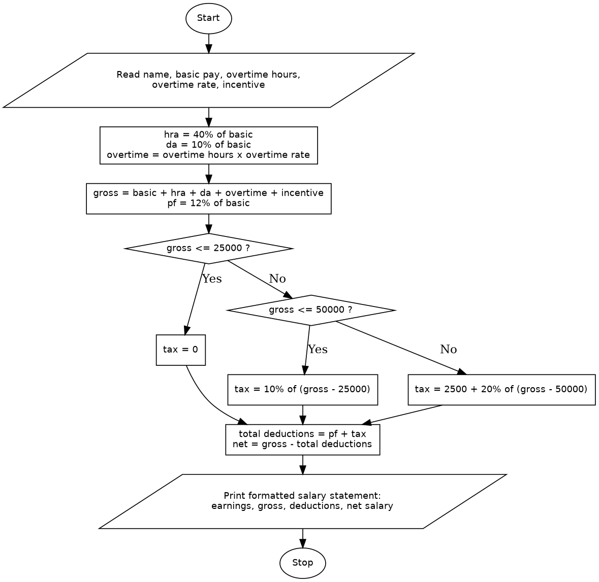

# Case Study 4: Employee Payroll and Deduction Analysis

## 1. Problem Statement
Write a Python program that calculates an employee's gross salary from basic pay, allowances, overtime and incentives, applies progressive deductions, and generates a formatted salary statement showing the net salary.

## 2. Objectives
- To calculate allowances as percentages of the basic pay and add all earnings to get the gross salary.
- To apply a progressive (slab-based) tax using conditional statements.
- To calculate deductions and the net salary.
- To print a neatly aligned salary statement using formatted output.

## 3. Assumptions
- House Rent Allowance (HRA) is 40% of the basic pay, and Dearness Allowance (DA) is 10% of the basic pay.
- Overtime pay is the overtime hours multiplied by the overtime rate per hour.
- Gross salary = basic pay + HRA + DA + overtime + incentive.
- Provident Fund (PF) is 12% of the basic pay.
- Income tax is calculated on the gross salary using progressive slabs:
  - up to 25000: 0%
  - the part from 25000 to 50000: 10%
  - the part above 50000: 20%
- Total deductions = PF + income tax, and net salary = gross salary - total deductions.
- All inputs are valid non-negative numbers. (The program does not validate the input type.)
- Functions are outside the assigned syllabus, so none are used.

## 4. Algorithm
1. Start.
2. Read the employee name, basic pay, overtime hours, overtime rate and incentive.
3. Calculate HRA (40% of basic pay), DA (10% of basic pay) and overtime pay (hours x rate).
4. Calculate the gross salary: basic pay + HRA + DA + overtime + incentive.
5. Calculate the provident fund: 12% of the basic pay.
6. If the gross salary is 25000 or less, set the tax to 0.
7. Otherwise, if the gross salary is 50000 or less, set the tax to 10% of (gross - 25000).
8. Otherwise, set the tax to 2500 plus 20% of (gross - 50000).
9. Calculate the total deductions: PF + tax.
10. Calculate the net salary: gross salary - total deductions.
11. Print the salary statement with the earnings, gross salary, deductions and net salary.
12. Stop.

## 5. Pseudocode
```
START
    READ name, basic, overtime_hours, overtime_rate, incentive
    hra = basic * 40 / 100
    da = basic * 10 / 100
    overtime = overtime_hours * overtime_rate
    gross = basic + hra + da + overtime + incentive
    pf = basic * 12 / 100
    IF gross <= 25000 THEN
        tax = 0
    ELSE IF gross <= 50000 THEN
        tax = (gross - 25000) * 10 / 100
    ELSE
        tax = 25000 * 10 / 100 + (gross - 50000) * 20 / 100
    END IF
    total_deductions = pf + tax
    net = gross - total_deductions
    PRINT salary statement (earnings, gross, deductions, net)
STOP
```

## 6. Flowchart


## 7. Python Source Code
See [`employee_payroll.py`](employee_payroll.py).

```python
# This program calculates the gross salary, deductions and net salary of an employee
# and prints a formatted salary statement.
name = input("Employee name: ")
basic = float(input("Basic pay: "))
overtime_hours = float(input("Overtime hours: "))
overtime_rate = float(input("Overtime rate per hour: "))
incentive = float(input("Incentive: "))

# Allowances and gross salary
hra = basic * 40 / 100
da = basic * 10 / 100
overtime = overtime_hours * overtime_rate
gross = basic + hra + da + overtime + incentive

# Deductions
pf = basic * 12 / 100
if gross <= 25000:
    tax = 0
elif gross <= 50000:
    tax = (gross - 25000) * 10 / 100
else:
    tax = 25000 * 10 / 100 + (gross - 50000) * 20 / 100
total_deductions = pf + tax
net = gross - total_deductions

# Salary statement
print("\n==============================")
print("        SALARY STATEMENT")
print("==============================")
print(f"Employee name   : {name}")
print("------------------------------")
print("EARNINGS")
print(f"Basic pay       : {basic:10.2f}")
print(f"HRA (40%)       : {hra:10.2f}")
print(f"DA (10%)        : {da:10.2f}")
print(f"Overtime        : {overtime:10.2f}")
print(f"Incentive       : {incentive:10.2f}")
print(f"Gross salary    : {gross:10.2f}")
print("------------------------------")
print("DEDUCTIONS")
print(f"Provident fund  : {pf:10.2f}")
print(f"Income tax      : {tax:10.2f}")
print(f"Total deduction : {total_deductions:10.2f}")
print("------------------------------")
print(f"NET SALARY      : {net:10.2f}")
print("==============================")
```

## 8. Test Cases
Inputs are in the order: name, basic pay, overtime hours, overtime rate, incentive.

| No. | Inputs | Expected Output | Actual Output | Result |
|----|--------|-----------------|---------------|--------|
| 1 | Ravi, 30000, 10, 200, 5000 | Gross 52000.00, PF 3600.00, tax 2900.00, net 45500.00 | Same as expected | Pass |
| 2 | Sita, 15000, 0, 0, 0 | Gross 22500.00, PF 1800.00, tax 0.00, net 20700.00 | Same as expected | Pass |
| 3 | X, 10000, 0, 0, 10000 | Gross exactly 25000.00, PF 1200.00, tax 0.00, net 23800.00 | Same as expected | Pass |
| 4 | Y, 20000, 0, 0, 20000 | Gross exactly 50000.00, PF 2400.00, tax 2500.00, net 45100.00 | Same as expected | Pass |
| 5 | Z, 30000, 0, 0, 0 | Gross 45000.00, PF 3600.00, tax 2000.00, net 39400.00 | Same as expected | Pass |

## 9. Output Screenshots
| Test 1 | Test 2 | Test 3 |
|---|---|---|
|  |  |  |

| Test 4 | Test 5 |
|---|---|
|  |  |

## 10. Conclusion
The program calculates the gross salary from the basic pay, allowances, overtime and incentive, then applies a provident fund deduction and a progressive income tax to find the net salary. The slab logic taxes only the part of the salary that falls in each slab, and the test cases confirm the results at the slab boundaries of 25000 and 50000. The output is printed as an aligned salary statement. The program uses fixed allowance, provident fund and tax rates, assumes valid numeric input, and does not use functions because they were outside the assigned syllabus.
