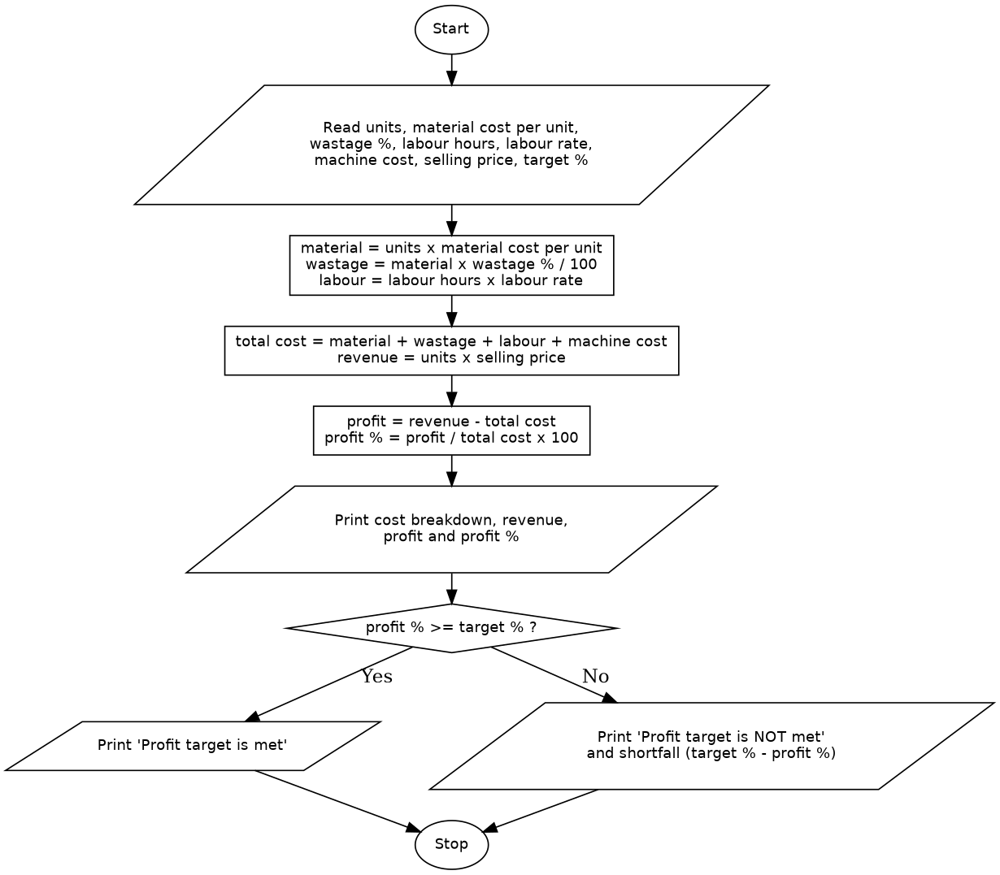

# Case Study 8: Manufacturing Cost and Profitability Analysis

## 1. Problem Statement
Write a Python program for a manufacturing unit that calculates the total production cost from the material cost, labour charges, wastage and machine cost. The program then computes the revenue from the selling price, finds the profit and profit percentage, and determines whether the production meets a specified profit target.

## 2. Objectives
- To calculate each component of the production cost and add them to get the total cost.
- To calculate revenue, profit and profit percentage from the selling price.
- To use a conditional statement to check whether the profit target is met.
- To display an itemised cost breakdown with values formatted to two decimal places.

## 3. Assumptions
- Wastage is a percentage of the material cost.
- Labour cost is labour hours multiplied by the labour rate per hour.
- Profit percentage is calculated on the total cost: profit / total cost x 100.
- Exactly meeting the target counts as meeting it.
- A negative profit means a loss and is reported as the target not being met.
- All inputs are valid non-negative numbers, and the total cost is greater than zero. (The program does not validate the input type.)
- Functions are outside the assigned syllabus, so none are used.

## 4. Algorithm
1. Start.
2. Read the number of units, material cost per unit, wastage percentage, labour hours, labour rate, machine cost, selling price per unit and target profit percentage.
3. Calculate the material cost: `units x material cost per unit`.
4. Calculate the wastage cost: `material cost x wastage % / 100`.
5. Calculate the labour cost: `labour hours x labour rate`.
6. Calculate the total cost: `material + wastage + labour + machine cost`.
7. Calculate the revenue: `units x selling price`.
8. Calculate the profit: `revenue - total cost`.
9. Calculate the profit percentage: `profit / total cost x 100`.
10. Print the cost breakdown, total cost, revenue, profit and profit percentage.
11. If the profit percentage is greater than or equal to the target, print that the target is met.
12. Otherwise, print that the target is not met and how many percentage points short it is.
13. Stop.

## 5. Pseudocode
```
START
    READ units, material_per_unit, wastage_percent, labour_hours,
         labour_rate, machine_cost, selling_price, target_percent
    material = units * material_per_unit
    wastage = material * wastage_percent / 100
    labour = labour_hours * labour_rate
    total_cost = material + wastage + labour + machine_cost
    revenue = units * selling_price
    profit = revenue - total_cost
    profit_percent = profit / total_cost * 100
    PRINT material, wastage, labour, machine_cost, total_cost
    PRINT revenue, profit, profit_percent
    IF profit_percent >= target_percent THEN
        PRINT "Profit target is met"
    ELSE
        PRINT "Profit target is NOT met"
        PRINT target_percent - profit_percent
    END IF
STOP
```

## 6. Flowchart


## 7. Python Source Code
See [`manufacturing_cost.py`](manufacturing_cost.py).

```python
# This program calculates the production cost, profit and profit percentage
# of a manufacturing unit and checks whether a profit target is met.
units = float(input("Number of units produced: "))
material_per_unit = float(input("Material cost per unit: "))
wastage_percent = float(input("Wastage percentage of material: "))
labour_hours = float(input("Labour hours: "))
labour_rate = float(input("Labour rate per hour: "))
machine_cost = float(input("Machine cost: "))
selling_price = float(input("Selling price per unit: "))
target_percent = float(input("Target profit percentage: "))

material = units * material_per_unit
wastage = material * wastage_percent / 100
labour = labour_hours * labour_rate
total_cost = material + wastage + labour + machine_cost
revenue = units * selling_price
profit = revenue - total_cost
profit_percent = profit / total_cost * 100

print("\n--- Cost Breakdown ---")
print(f"Material cost : {material:.2f}")
print(f"Wastage cost  : {wastage:.2f}")
print(f"Labour cost   : {labour:.2f}")
print(f"Machine cost  : {machine_cost:.2f}")
print(f"Total cost    : {total_cost:.2f}")
print(f"Revenue       : {revenue:.2f}")
print(f"Profit        : {profit:.2f}")
print(f"Profit %      : {profit_percent:.2f}%")

if profit_percent >= target_percent:
    print("Result: Profit target is met.")
else:
    print(f"Result: Profit target is NOT met. Short by {target_percent - profit_percent:.2f} percentage points.")
```

## 8. Test Cases
Inputs are in the order: units, material cost per unit, wastage %, labour hours, labour rate, machine cost, selling price, target %.

| No. | Inputs | Expected Output | Actual Output | Result |
|----|--------|-----------------|---------------|--------|
| 1 | 100, 50, 5, 40, 100, 1000, 120, 15 | Total cost 10250.00, revenue 12000.00, profit 1750.00, profit 17.07%. Target met | Same as expected | Pass |
| 2 | 100, 50, 5, 40, 100, 1000, 100, 15 | Total cost 10250.00, revenue 10000.00, profit -250.00, profit -2.44%. Target NOT met, short by 17.44 | Same as expected | Pass |
| 3 | 100, 50, 0, 40, 100, 1000, 110, 10 | Total cost 10000.00, profit 1000.00, profit 10.00%. Target met (exactly at the target) | Same as expected | Pass |
| 4 | 100, 50, 0, 40, 100, 1000, 110, 12 | Same profit of 10.00%. Target NOT met, short by 2.00 | Same as expected | Pass |
| 5 | 100, 50, 0, 40, 100, 1000, 100, 0 | Profit 0.00, profit 0.00%. Target met (break-even with a 0% target) | Same as expected | Pass |

## 9. Output Screenshots
| Test 1 | Test 2 | Test 3 |
|---|---|---|
|  |  |  |

| Test 4 | Test 5 |
|---|---|
|  |  |

## 10. Conclusion
The program calculates the material, wastage, labour and machine costs of a production run, adds them to get the total cost, and compares the revenue with that cost to find the profit and profit percentage. A conditional statement then checks the result against the target and reports how far short it is when the target is not met. The test cases show correct results for profit, loss, an exact match with the target and break-even. The program assumes valid numeric input and a total cost above zero, and it does not use functions because they were outside the assigned syllabus.
