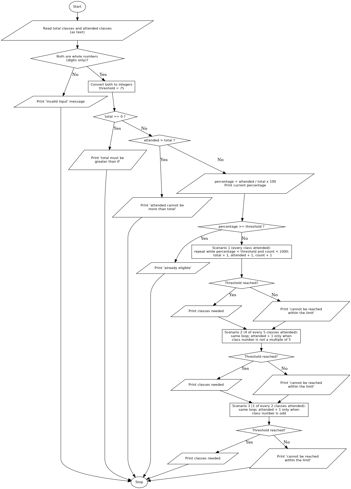

# Case Study 12: Attendance Recovery Computation

## 1. Problem Statement
Write a Python program that calculates a student's current attendance percentage and determines the minimum number of future classes required to reach the eligibility threshold under different future attendance scenarios.

## 2. Objectives
- To calculate an attendance percentage from the classes attended and the total classes held.
- To use a loop to simulate future classes one at a time and update the percentage after each class.
- To use the remainder operator (`%`) to model different attendance patterns.
- To use conditional statements for threshold checking and input validation.
- To handle the case where the threshold can never be reached, so that the loop always ends.

## 3. Assumptions
- The eligibility threshold is **75%**.
- Total classes and attended classes are entered as whole numbers. Letters, decimals, negative numbers and empty input are invalid.
- The total number of classes must be greater than 0, and the attended classes cannot be more than the total classes.
- The percentage is attended / total x 100, displayed to 2 decimal places.
- If the current percentage is already 75% or more, the student is eligible and no simulation is done.
- Three future scenarios are checked (future classes are numbered 1, 2, 3, ...):
  - **Scenario 1:** the student attends every future class (consecutive classes).
  - **Scenario 2:** the student attends 4 out of every 5 future classes (misses every 5th class).
  - **Scenario 3:** the student attends 1 out of every 2 future classes (misses every even-numbered class).
- Each simulation stops after at most **1000** future classes. If the threshold has not been reached by then, the program reports that it cannot be reached within the limit.
- Functions are outside the assigned syllabus, so the program is written without them and the loop is repeated for each scenario.

## 4. Algorithm
1. Start.
2. Read the total classes and the attended classes as text.
3. If either value is not made of digits only, print an invalid-input message and go to step 24.
4. Convert both values to integers and set `threshold = 75`.
5. If total is 0, print the message and go to step 24.
6. If attended is greater than total, print the message and go to step 24.
7. Calculate the current percentage and print it.
8. If the percentage is at least 75, print that the student is already eligible and go to step 24.
9. **Scenario 1:** set `a = attended`, `t = total`, `count = 0`.
10. While `a / t x 100` is less than 75 and `count` is less than 1000: add 1 to `t`, add 1 to `a`, add 1 to `count`.
11. If the percentage is now at least 75, print `count` as the classes needed. Otherwise, print that the threshold cannot be reached within the limit.
12. **Scenario 2:** set `a = attended`, `t = total`, `count = 0`.
13. While the percentage is less than 75 and `count` is less than 1000: add 1 to `count` and `t`; add 1 to `a` only if `count` is not a multiple of 5.
14. If the percentage is now at least 75, print `count`. Otherwise, print that the threshold cannot be reached within the limit.
15. **Scenario 3:** set `a = attended`, `t = total`, `count = 0`.
16. While the percentage is less than 75 and `count` is less than 1000: add 1 to `count` and `t`; add 1 to `a` only if `count` is odd.
17. If the percentage is now at least 75, print `count`. Otherwise, print that the threshold cannot be reached within the limit.
18. Stop.

## 5. Pseudocode
```
START
    READ total_text, attended_text
    IF total_text or attended_text is not all digits THEN
        PRINT "invalid input"
    ELSE
        total = integer(total_text)
        attended = integer(attended_text)
        threshold = 75
        IF total = 0 THEN
            PRINT "total must be greater than 0"
        ELSE IF attended > total THEN
            PRINT "attended cannot be more than total"
        ELSE
            percentage = attended / total * 100
            PRINT percentage
            IF percentage >= threshold THEN
                PRINT "already eligible"
            ELSE
                // Scenario 1: every class attended
                a = attended, t = total, count = 0
                WHILE a / t * 100 < threshold AND count < 1000
                    count = count + 1, t = t + 1, a = a + 1
                END WHILE
                IF a / t * 100 >= threshold THEN PRINT count
                ELSE PRINT "cannot be reached within the limit"

                // Scenario 2: 4 of every 5 classes attended
                a = attended, t = total, count = 0
                WHILE a / t * 100 < threshold AND count < 1000
                    count = count + 1, t = t + 1
                    IF count is not a multiple of 5 THEN a = a + 1
                END WHILE
                IF a / t * 100 >= threshold THEN PRINT count
                ELSE PRINT "cannot be reached within the limit"

                // Scenario 3: 1 of every 2 classes attended
                a = attended, t = total, count = 0
                WHILE a / t * 100 < threshold AND count < 1000
                    count = count + 1, t = t + 1
                    IF count is odd THEN a = a + 1
                END WHILE
                IF a / t * 100 >= threshold THEN PRINT count
                ELSE PRINT "cannot be reached within the limit"
            END IF
        END IF
    END IF
STOP
```

## 6. Flowchart


## 7. Python Source Code
See [`attendance_recovery.py`](attendance_recovery.py).

```python
# Paste your final code here
```

## 8. Test Cases
Fill in the Actual Output and Result columns from your own runs, using your program's exact messages.

| No. | Total | Attended | Expected Output | Actual Output | Result |
|----|-------|----------|-----------------|---------------|--------|
| 1 | 45 | 30 | Current 66.67%. Scenario 1: 15 classes. Scenario 2: 59 classes. Scenario 3: cannot be reached | | |
| 2 | 50 | 40 | Current 80.00%. Already eligible | | |
| 3 | 20 | 15 | Current 75.00%. Already eligible (exactly at the threshold) | | |
| 4 | 60 | 30 | Current 50.00%. Scenario 1: 60 classes. Scenario 2: 284 classes. Scenario 3: cannot be reached | | |
| 5 | 100 | 0 | Current 0.00%. Scenario 1: 300 classes. Scenario 2: cannot be reached within the limit. Scenario 3: cannot be reached | | |
| 6 | 0 | 0 | "Total must be greater than 0" message | | |
| 7 | 20 | 25 | "Attended cannot be more than total" message | | |
| 8 | abc | 10 | "Invalid input" message | | |
| 9 | 50 | -5 | "Invalid input" message | | |
| 10 | 2.5 | 2 | "Invalid input" message | | |

## 9. Output Screenshots
| Test 1 | Test 2 | Test 3 | Test 4 | Test 5 |
|---|---|---|---|---|
|  |  |  |  |  |

| Test 6 | Test 7 | Test 8 | Test 9 | Test 10 |
|---|---|---|---|---|
|  |  |  |  |  |

## 10. Conclusion
The program calculates a student's current attendance percentage and uses loop-based simulation to find how many future classes are needed to reach 75% under three attendance patterns. Attending every class always recovers fastest, a pattern with a lower attendance rate takes much longer, and a pattern at or below the threshold rate can never reach it from a lower starting point. The limit of 1000 classes stops the loops from running forever in those cases. The program accepts whole numbers only, uses a fixed threshold and fixed scenarios, and repeats the loop for each scenario because functions were outside the assigned syllabus.
