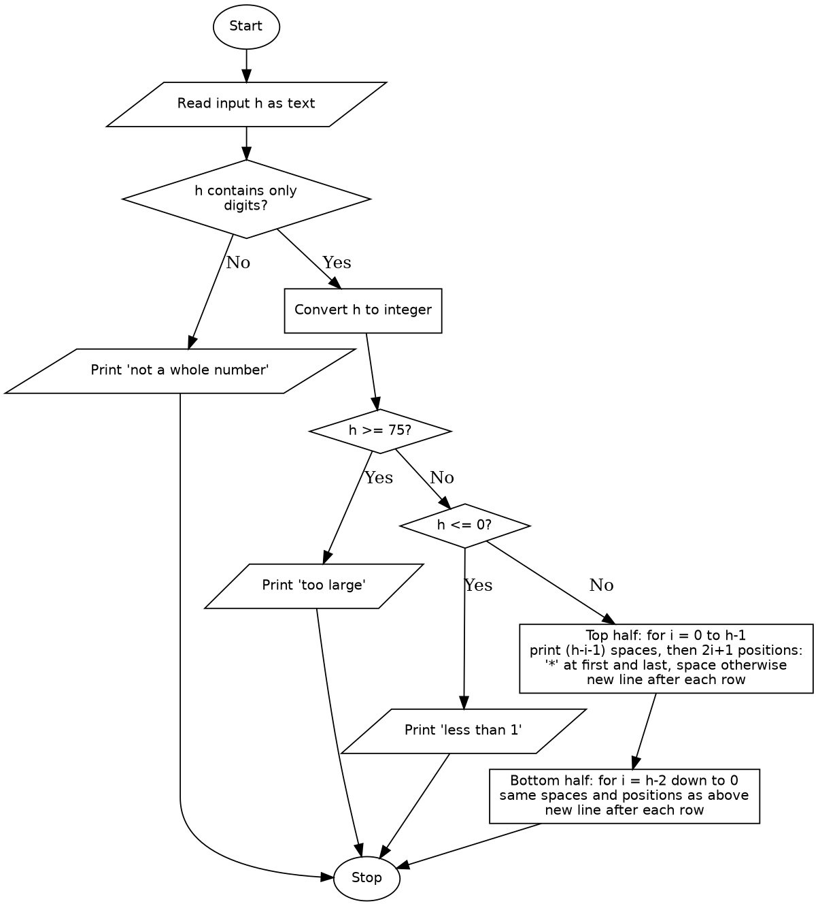

# Case Study 27: Advanced Numeric Pattern Generator (Hollow Diamond)

## 1. Problem Statement
Write a Python program that reads a height from the user and prints a hollow diamond pattern of that size with carefully aligned output. The program must validate the input and reject invalid dimensions.

## 2. Objectives
- To practise nested loops to generate a two-dimensional pattern.
- To work out the relationship between the row number, the leading spaces and the width of each row.
- To validate user input (non-numeric, zero, negative, decimal and oversized values) before using it.
- To use conditional statements (`if`, `elif`, `else`) to handle different cases.
- To use string methods (`isdigit()`) and type conversion (`int()`).

## 3. Assumptions
- The input `h` is the number of rows in the top half of the diamond, including the widest row, so the full diamond has `2*h - 1` rows.
- Only whole positive numbers are accepted. Decimals, negative numbers, letters, spaces and empty input are treated as invalid.
- The valid range is 1 to 74. A height of 75 or more gives a diamond wider than about 150 characters, which does not display properly in a normal terminal.
- Stars (`*`) are used to draw the pattern.
- Functions are outside the assigned syllabus, so the top-half and bottom-half loops are written separately.

## 4. Algorithm
1. Start.
2. Read the height as text and store it in `h`.
3. If `h` does not contain only digits, print an error message and go to step 14.
4. Convert `h` to an integer.
5. If `h` is 75 or more, print the "too large" message and go to step 14.
6. If `h` is 0 (or less), print the "less than 1" message and go to step 14.
7. **Top half:** for each row `i` from 0 to `h-1`:
   1. Print `h - i - 1` spaces.
   2. For each position `j` from 0 to `2*i`: print `*` if `j` is the first or last position, otherwise print a space.
   3. Move to the next line.
8. **Bottom half:** for each row `i` from `h-2` down to 0:
   1. Print `h - i - 1` spaces.
   2. For each position `j` from 0 to `2*i`: print `*` if `j` is the first or last position, otherwise print a space.
   3. Move to the next line.
9. The bottom half starts at `h-2` so that the widest row is not printed twice.
10. Stop.

## 5. Pseudocode
```
START
    READ h as text
    IF h does not contain only digits THEN
        PRINT "not a whole number" message
    ELSE
        h = integer value of h
        IF h >= 75 THEN
            PRINT "too large" message
        ELSE IF h <= 0 THEN
            PRINT "less than 1" message
        ELSE
            FOR i = 0 TO h-1
                PRINT (h - i - 1) spaces
                FOR j = 0 TO 2*i
                    IF j = 0 OR j = 2*i THEN
                        PRINT "*"
                    ELSE
                        PRINT " "
                    END IF
                END FOR
                PRINT new line
            END FOR
            FOR i = h-2 DOWN TO 0
                PRINT (h - i - 1) spaces
                FOR j = 0 TO 2*i
                    IF j = 0 OR j = 2*i THEN
                        PRINT "*"
                    ELSE
                        PRINT " "
                    END IF
                END FOR
                PRINT new line
            END FOR
        END IF
    END IF
STOP
```

## 6. Flowchart


## 7. Python Source Code
See [`hollow_diamond.py`](hollow_diamond.py).

```python
# This program is to print a hollow diamond pattern 
h  = (input("Enter the height of the of pattern(1-74) :"))
if h.startswith("-") and h[1:].isdigit():
    print("Negative number entered. Please enter a number between 1 and 74.")
elif not h.isdigit():
    print("Invalid input. Please enter a whole number between 1 and 74.")
else :
        h = int(h)
        if h >= 75:
            print("given number is greater the pattern will not be printed well give number less than 75.")
        elif h <= 0 :
            print("given number is less than 1 the pattern will not be printed well give number greater than 0.")
  
        else:
            
            for i in range(h):
                for j in range(h-i-1):
                    print(" ", end="")
                for j in range(2*i+1):
                    if j == 0 or j == 2*i:
                        print("*", end="")
                    else:
                        print(" ", end="")
                print()
            for i in range(h-2, -1, -1):
                for j in range(h-i-1):
                    print(" ", end="")
                for j in range(2*i+1):
                    if j == 0 or j == 2*i:
                        print("*", end="")
                    else:
                        print(" ", end="")
                print()


         
    

## 8. Test Cases

| No. | Input | Expected Output | Actual Output | Result |
|----|-------|-----------------|---------------|--------|
| 1 | `1` | A single `*` | A single `*` | Pass |
| 2 | `2` | 3 rows: `*`, then `* *`, then `*` (centred) | 3 rows, as expected | Pass |
| 3 | `5` | Symmetric hollow diamond with 9 rows | 9 rows, symmetric | Pass |
| 4 | `8` | Symmetric hollow diamond with 15 rows | 15 rows, symmetric | Pass |
| 5 | `74` | Largest valid diamond with 147 rows | 147 rows | Pass |
| 6 | `75` | "Too large" message | "Given number is too large..." | Pass |
| 7 | `0` | "Less than 1" message | "Given number is less than 1..." | Pass |
| 8 | `-3` | "Not a whole number" message | "Given input is not a whole number..." | Pass |
| 9 | `2.5` | "Not a whole number" message | "Given input is not a whole number..." | Pass |
| 10 | `abc` | "Not a whole number" message | "Given input is not a whole number..." | Pass |
| 11 | (empty, just Enter) | "Not a whole number" message | "Given input is not a whole number..." | Pass |

## 9. Output Screenshots
Valid inputs:

| Input 1 | Input 2 | Input 5 |
|---|---|---|
|  |  |  |

| Input 8 | Input 74 |
|---|---|
|  |  |

Invalid inputs:

| Input 75 | Input 0 | Input -3 |
|---|---|---|
|  |  |  |

| Input 2.5 | Input abc | Empty input |
|---|---|---|
|  |  |  |

## 10. Conclusion
This program prints a hollow diamond of any height from 1 to 74 by using nested loops, with leading spaces of `h-i-1` and a row width of `2*i+1`. Starting the bottom half at `h-2` avoids repeating the widest row. Checking the input with `isdigit()` before converting it with `int()` prevents crashes on invalid input, and separate messages explain each kind of error. The main limits are the fixed upper bound of 74 and the repeated loop code, since functions were not part of the assigned syllabus.
