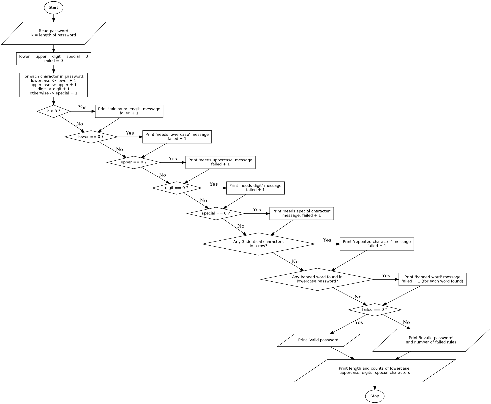

# Case Study 29: Password Policy Validation Engine

## 1. Problem Statement
Write a Python program that evaluates a password against a set of policy rules: minimum length, required character categories, repetition of characters, and prohibited substrings. The program must explain every rule that the password fails.

## 2. Objectives
- To traverse a string character by character and classify each character as lowercase, uppercase, digit or special.
- To keep counters for each character category and use them to check the policy rules.
- To use conditional statements so that every failed rule is reported, not only the first one.
- To check repeated characters by comparing neighbouring positions in a string.
- To search for prohibited substrings using a list and the `in` operator.

## 3. Assumptions
- The password is a single line of text entered by the user.
- **Rule 1:** the minimum length is 8 characters.
- **Rules 2 to 5:** the password must contain at least one lowercase letter, one uppercase letter, one digit and one special character.
- **Rule 6:** the same character must not appear 3 times in a row. The comparison is case-sensitive, so `Aaa` is not counted as a repetition.
- **Rule 7:** the password must not contain any word from the banned list `password`, `1234` and `qwerty`. This check is not case-sensitive (the password is converted to lowercase for the check only).
- Any character that is not a letter or a digit (including a space) is counted as a special character.
- Characters outside the standard English letters and digits (for example accented letters) are also counted as special characters.
- Functions are outside the assigned syllabus, so the program is written without them.

## 4. Algorithm
1. Start.
2. Read the password and store its length in `k`.
3. Set `lower`, `upper`, `digit` and `special` to 0, and `failed` to 0.
4. For each character in the password:
   1. If it is a lowercase letter, add 1 to `lower`.
   2. Otherwise, if it is an uppercase letter, add 1 to `upper`.
   3. Otherwise, if it is a digit, add 1 to `digit`.
   4. Otherwise, add 1 to `special`.
5. **Rule 1:** if `k` is less than 8, print the length message and add 1 to `failed`.
6. **Rule 2:** if `lower` is 0, print the message and add 1 to `failed`.
7. **Rule 3:** if `upper` is 0, print the message and add 1 to `failed`.
8. **Rule 4:** if `digit` is 0, print the message and add 1 to `failed`.
9. **Rule 5:** if `special` is 0, print the message and add 1 to `failed`.
10. **Rule 6:** for each position `i` from 0 to `k - 3`, if the characters at `i`, `i + 1` and `i + 2` are all the same, print the message, add 1 to `failed`, and stop checking this rule.
11. **Rule 7:** for each word in the banned list, if the word appears in the lowercase password, print the message and add 1 to `failed`.
12. If `failed` is 0, print "Valid password". Otherwise, print "Invalid password" and the number of failed rules.
13. Print the password length and the counts of lowercase letters, uppercase letters, digits and special characters.
14. Stop.

## 5. Pseudocode
```
START
    READ password
    k = length of password
    lower = 0, upper = 0, digit = 0, special = 0, failed = 0

    FOR each character ch in password
        IF ch is lowercase THEN lower = lower + 1
        ELSE IF ch is uppercase THEN upper = upper + 1
        ELSE IF ch is a digit THEN digit = digit + 1
        ELSE special = special + 1
        END IF
    END FOR

    IF k < 8 THEN PRINT length message; failed = failed + 1
    IF lower = 0 THEN PRINT lowercase message; failed = failed + 1
    IF upper = 0 THEN PRINT uppercase message; failed = failed + 1
    IF digit = 0 THEN PRINT digit message; failed = failed + 1
    IF special = 0 THEN PRINT special character message; failed = failed + 1

    FOR i = 0 TO k - 3
        IF password[i] = password[i+1] AND password[i+1] = password[i+2] THEN
            PRINT repetition message
            failed = failed + 1
            STOP this loop
        END IF
    END FOR

    banned = ["password", "1234", "qwerty"]
    FOR each word in banned
        IF word is found in lowercase(password) THEN
            PRINT banned word message
            failed = failed + 1
        END IF
    END FOR

    IF failed = 0 THEN
        PRINT "Valid password"
    ELSE
        PRINT "Invalid password" and failed
    END IF
    PRINT length and counts of each character category
STOP
```

## 6. Flowchart


## 7. Python Source Code
See [`password_validation.py`](password_validation.py).

```python
#this program is for password validation
password = input("Enter your password: ")
k = len(password)
lower = 0
upper = 0
digit = 0
special = 0
for i in password:
    if i.islower():
        lower += 1
    elif i.isupper():
        upper += 1
    elif i.isdigit():
        digit += 1
    else:
        special += 1
    
failed = 0

# Rule 1: minimum length
if k < 8:
    print("Rule failed: password must be at least 8 characters long")
    failed += 1

# Rules 2-5: character categories (using your counters)
if lower == 0:
    print("Rule failed: needs at least one lowercase letter")
    failed += 1
if upper == 0:
    print("Rule failed: needs at least one uppercase letter")
    failed += 1
if digit == 0:
    print("Rule failed: needs at least one digit")
    failed += 1
if special == 0:
    print("Rule failed: needs at least one special character")
    failed += 1

# Rule 6: no 3 identical characters in a row
for i in range(k - 2):
    if password[i] == password[i + 1] == password[i + 2]:
        print("Rule failed: the same character appears 3 times in a row")
        failed += 1
        break

# Rule 7: banned words (checked in lowercase)
banned = ["password", "1234", "qwerty"]
for word in banned:
    if word in password.lower():
        print("Rule failed: contains the banned word '" + word + "'")
        failed += 1

# Final result
if failed == 0:
    print("Valid password")
else:
    print("Invalid password,", failed, "rule(s) failed")
print(f"Password length: {k}, Lowercase: {lower}, Uppercase: {upper}, Digits: {digit}, Special characters: {special}")
```

## 8. Test Cases

| No. | Input | Expected Result | Actual Output |  Result |
|----|-------|-----------------|---------------|--------|
| 1 | `Abc@5678x` | Valid password | "Valid password"; counts 3 lower, 1 upper, 4 digits, 1 special | Pass |
| 2 | `Ab@1` | Length rule fails | 1 rule failed (minimum length) | Pass |
| 3 | `abcdefgh` | Uppercase, digit and special rules fail | 3 rules failed | Pass |
| 4 | `Abbb@5678x` | Repetition rule fails | 1 rule failed (same character 3 times in a row) | Pass |
| 5 | `MyPassword@1` | Banned-word rule fails | 1 rule failed (banned word 'password') | Pass |
| 6 | `abc` | Length, uppercase, digit and special rules fail | 4 rules failed | Pass |
| 7 | `Abc@1234x` | Banned-word rule fails | 1 rule failed (banned word '1234') | Pass |
| 8 | (empty, just Enter) | Length and all four category rules fail | 5 rules failed, all counts 0 | Pass |

## 9. Output Screenshots
| Test 1 | Test 2 | Test 3 | Test 4 |
|---|---|---|---|
|  |  |  |  |

| Test 5 | Test 6 | Test 7 | Test 8 |
|---|---|---|---|
|  |  |  |  |

## 10. Conclusion
The program classifies each character of a password, counts the characters in each category, and checks the password against seven rules: minimum length, four character categories, repeated characters and banned words. Because every rule is tested with its own `if` statement, a password that breaks several rules gets every reason printed. The program is case-sensitive for the repetition rule, treats any non-alphanumeric character as special, and uses a short fixed list of banned words. It does not use functions, since they were outside the assigned syllabus.
