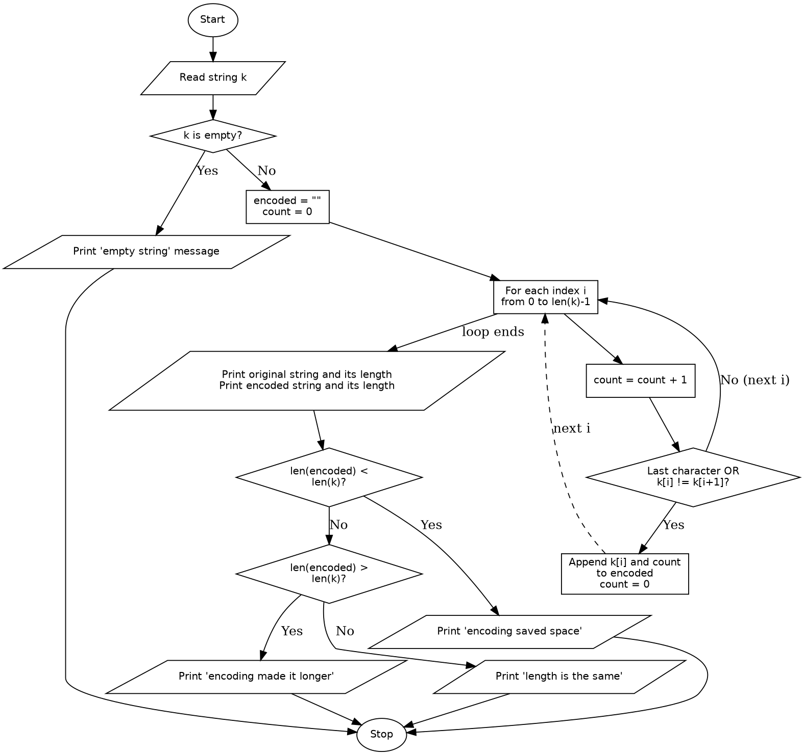

# Case Study 35: Text Compression Using Character Runs (Run-Length Encoding)

## 1. Problem Statement
Write a Python program that encodes a string by grouping consecutive repeated characters into a character-and-count pair (for example, `aaabbc` becomes `a3b2c1`). The program must compare the lengths of the original and encoded strings and report the result, including cases where encoding does not reduce the length.

## 2. Objectives
- To traverse a string character by character using a loop and indexing.
- To compare each character with the next one to detect where a run ends.
- To build a new string step by step using string concatenation and type conversion (`str()`).
- To use conditional statements to compare lengths and report whether encoding helped.
- To handle edge cases such as empty input, a single character, and a string with no repeats.

## 3. Assumptions
- The input is a single line of text entered by the user.
- Uppercase and lowercase letters are treated as different characters (for example, `AAaa` is encoded as `A2a2`).
- Digits, spaces and symbols are encoded like any other character.
- An empty input is rejected with a message and no encoding is done.
- Only encoding is required; decoding is not part of this program. (If the input already contains digits, the encoded text may be ambiguous to decode.)
- Functions are outside the assigned syllabus, so the program is written without them.

## 4. Algorithm
1. Start.
2. Read the string `k` from the user.
3. If `k` is empty, print an error message and go to step 12.
4. Set `encoded` to an empty string and `count` to 0.
5. For each index `i` from 0 to `len(k) - 1`:
   1. Add 1 to `count`.
   2. If `i` is the last index, or `k[i]` is different from `k[i + 1]`, the current run has ended: append `k[i]` followed by `count` (as text) to `encoded`, then set `count` back to 0.
6. Print the original string and its length.
7. Print the encoded string and its length.
8. If the length of `encoded` is less than the length of `k`, print that encoding saved space.
9. Otherwise, if the length of `encoded` is greater than the length of `k`, print that encoding made the string longer.
10. Otherwise, print that the lengths are the same.
11. Stop.

## 5. Pseudocode
```
START
    READ k
    IF k is empty THEN
        PRINT "empty string" message
    ELSE
        encoded = ""
        count = 0
        FOR i = 0 TO length(k) - 1
            count = count + 1
            IF i is the last index OR k[i] != k[i+1] THEN
                encoded = encoded + k[i] + text(count)
                count = 0
            END IF
        END FOR
        PRINT original string and length(k)
        PRINT encoded string and length(encoded)
        IF length(encoded) < length(k) THEN
            PRINT "encoding saved space"
        ELSE IF length(encoded) > length(k) THEN
            PRINT "encoding made the string longer"
        ELSE
            PRINT "length is the same"
        END IF
    END IF
STOP
```

## 6. Flowchart


## 7. Python Source Code
See [`run_length_encoding.py`](run_length_encoding.py).

```python
# Paste your final code here
```

## 8. Test Cases
Fill in the Actual Output and Result columns from your own runs, using your program's exact messages.

| No. | Input | Expected Encoded Output | Lengths (original / encoded) | Expected Comparison | Actual Output | Result |
|----|-------|------------------------|------------------------------|---------------------|---------------|--------|
| 1 | `aaabbc` | `a3b2c1` | 6 / 6 | Same length | | |
| 2 | `aaaaaaaaaa` | `a10` | 10 / 3 | Encoding saved space | | |
| 3 | `abc` | `a1b1c1` | 3 / 6 | Encoding made it longer | | |
| 4 | `a` | `a1` | 1 / 2 | Encoding made it longer | | |
| 5 | `AAaa` | `A2a2` | 4 / 4 | Same length (case-sensitive) | | |
| 6 | `hello` | `h1e1l2o1` | 5 / 8 | Encoding made it longer | | |
| 7 | `aAaA` | `a1A1a1A1` | 4 / 8 | Encoding made it longer | | |
| 8 | (empty, just Enter) | None | - | "Empty string" message | | |

## 9. Output Screenshots
| Test 1 | Test 2 | Test 3 | Test 4 |
|---|---|---|---|
|  |  |  |  |

| Test 5 | Test 6 | Test 7 | Test 8 |
|---|---|---|---|
|  |  |  |  |

## 10. Conclusion
The program encodes a string by counting runs of repeated characters, comparing each character with the next one to find where a run ends. It reports the original and encoded lengths and whether encoding helped. The test cases show that run-length encoding saves space only when the input has long runs; for strings with few repeats, such as `abc`, the encoded text is longer. The program treats uppercase and lowercase letters as different characters, does not include decoding, and does not use functions because they were outside the assigned syllabus.
