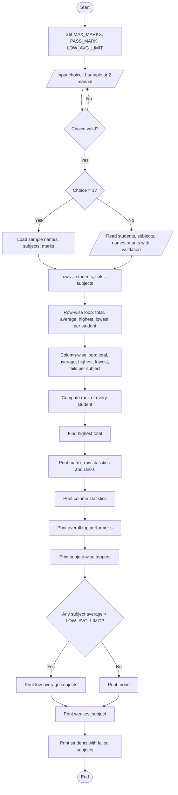

# Case Study 42: Student Marks Matrix Analysis

**Course:** Python Programming | **Activity:** Python Activity-Based Learning
**Repository:** `PythonActivity-Based-Learning` → folder `case-study-42`

---

## 1. Problem Statement

Analyse a matrix of student marks across subjects. The program must calculate **row-wise** (per student) and **column-wise** (per subject) statistics, identify **top performers**, and detect **subjects with low average performance**.

## 2. Objectives

1. Store marks of several students in several subjects using a **nested list**.
2. Compute each student's total, average, highest and lowest mark (row-wise).
3. Compute each subject's total, average, highest, lowest mark and number of failures (column-wise).
4. Rank students and identify the overall topper(s), handling ties.
5. Identify the topper(s) in every subject.
6. Flag subjects whose class average is below a given limit.
7. Validate all user inputs (non-empty names, marks between 0 and 100).

## 3. Assumptions

- Maximum marks per subject = **100**; marks are whole numbers from 0 to 100.
- Pass mark per subject = **40**.
- A subject has **low average performance** if its class average is **below 50**.
- Every student has marks for every subject (no missing values).
- Tied students share the same rank (rank = 1 + number of students with a strictly higher total).
- Only syllabus topics are used: variables, operators, conditionals, loops, strings, lists, nested lists (no functions, dictionaries or imports).

## 4. Algorithm

1. Start. Set `MAX_MARKS = 100`, `PASS_MARK = 40`, `LOW_AVG_LIMIT = 50`.
2. Ask the user to choose sample data or manual entry (repeat until the choice is 1 or 2).
3. If sample data: load `names`, `subjects` and the nested list `marks`. Otherwise read the number of students and subjects, the names, and every mark, validating each input.
4. For each student (row): compute total, average, highest, lowest.
5. For each subject (column): compute total, average, highest, lowest and count of marks below `PASS_MARK`.
6. For each student: rank = 1 + count of students with a higher total.
7. Find the highest total and print every student with that total (top performers).
8. For each subject, print every student who scored the subject's highest mark.
9. Print every subject whose average is below `LOW_AVG_LIMIT`; if none, say so. Print the weakest subject.
10. Print each student's failed subjects, if any.
11. Stop.

## 5. Flowchart



## 6. Pseudocode

```
START
  SET MAX_MARKS = 100, PASS_MARK = 40, LOW_AVG_LIMIT = 50
  READ choice
  WHILE choice is not 1 and not 2: READ choice

  IF choice = 1 THEN
      LOAD names, subjects, marks (sample data)
  ELSE
      READ n, m (validated positive integers)
      FOR j = 1 TO m: READ subjects[j]
      FOR i = 1 TO n
          READ names[i]
          FOR j = 1 TO m
              READ mark (repeat until 0 <= mark <= MAX_MARKS)
              ADD mark to row i of marks
  ENDIF

  rows = n ; cols = m

  FOR i = 0 TO rows-1
      total = 0 ; high = marks[i][0] ; low = marks[i][0]
      FOR j = 0 TO cols-1
          total = total + marks[i][j]
          UPDATE high and low
      STORE total, total/cols, high, low

  FOR j = 0 TO cols-1
      total = 0 ; fails = 0 ; high = marks[0][j] ; low = marks[0][j]
      FOR i = 0 TO rows-1
          total = total + marks[i][j]
          UPDATE high and low
          IF marks[i][j] < PASS_MARK THEN fails = fails + 1
      STORE total, total/rows, high, low, fails

  FOR i = 0 TO rows-1
      rank = 1
      FOR k = 0 TO rows-1
          IF totals[k] > totals[i] THEN rank = rank + 1
      STORE rank

  best = maximum of totals
  PRINT matrix with row statistics and ranks
  PRINT column statistics
  FOR each student with total = best: PRINT as top performer
  FOR each subject j: PRINT all students with marks = highest of j
  FOR each subject j
      IF average[j] < LOW_AVG_LIMIT THEN PRINT subject as low performing
  IF none printed THEN PRINT "None"
  PRINT subject with smallest average
  FOR each student: PRINT subjects where mark < PASS_MARK
END
```

## 7. Python Source Code

See [`student_marks_matrix.py`](student_marks_matrix.py).

Run it with:

```
python student_marks_matrix.py
```

## 8. Test Cases

| # | Input | Expected result | Result |
|---|-------|-----------------|--------|
| 1 | Menu choice `1` (sample data, 6 students × 5 subjects) | Topper = Bhavya (439); Eshwar rank 6; Charan fails Physics; Eshwar fails Maths and Chemistry | Pass |
| 2 | Menu choice `5`, then `1` | "Invalid choice" shown, then program continues | Pass |
| 3 | Manual: 2 students, 2 subjects, Ria 95/88, Sam 95/88 | Tie: both rank 1, both listed as top performers; both toppers in each subject | Pass |
| 4 | Manual: mark `101` entered | "Invalid. Enter 0-100" shown and mark re-asked | Pass |
| 5 | Manual: number of students `0` or `abc` | Asked again until a positive whole number is given | Pass |
| 6 | Manual: all marks ≥ 40 | "None. All students passed every subject." | Pass |
| 7 | Manual: Maths marks 30 and 40 (average 35) | Maths flagged as low-average subject | Pass |
| 8 | Manual: 1 student, 1 subject, mark 0 | Total 0, average 0.00, rank 1, fails 1, Maths flagged low | Pass |

## 9. Output Screenshots

> Run the program in your terminal/IDLE, take screenshots, and place them in an `screenshots/` folder, then link them here, e.g. ``.

Text output of test case 1 (also saved in [`sample_output.txt`](sample_output.txt)):

```
==================================================================
         STUDENT MARKS MATRIX ANALYSIS
==================================================================
MARKS MATRIX WITH ROW-WISE STATISTICS
-------------------------------------------------------------------------------------------------------
Student          Maths   Physics Chemistry   English    Python   Total     Avg  High  Low  Rank
-------------------------------------------------------------------------------------------------------
Aarav               78        65        70        82        90     385   77.00    90   65     3
Bhavya              92        88        85        79        95     439   87.80    95   79     1
Charan              45        38        52        60        55     250   50.00    60   38     5
Divya               92        70        66        74        88     390   78.00    92   66     2
Eshwar              35        42        30        58        47     212   42.40    58   30     6
Farhan              60        55        48        66        72     301   60.20    72   48     4
-------------------------------------------------------------------------------------------------------

COLUMN-WISE (SUBJECT) STATISTICS
------------------------------------------------------------------
Subject        Total   Average   High   Low  Fails
------------------------------------------------------------------
Maths            402     67.00     92    35      1
Physics          358     59.67     88    38      1
Chemistry        351     58.50     85    30      1
English          419     69.83     82    58      0
Python           447     74.50     95    47      0
------------------------------------------------------------------

TOP PERFORMER(S) OVERALL (highest total = 439)
  * Bhavya  (Average: 87.80)

SUBJECT-WISE TOPPERS
  Maths      : Bhavya, Divya (92)
  Physics    : Bhavya (88)
  Chemistry  : Bhavya (85)
  English    : Aarav (82)
  Python     : Bhavya (95)

SUBJECTS WITH LOW AVERAGE PERFORMANCE (average < 50)
  None. All subject averages are at or above 50.

Weakest subject overall : Chemistry (58.50)

STUDENTS WITH SUBJECT FAILURES (marks < 40)
  - Charan: Physics
  - Eshwar: Maths, Chemistry
==================================================================
```

## 10. Conclusion

The program shows how a **nested list** can represent a marks matrix and how **nested loops** produce both row-wise and column-wise statistics from the same data. It correctly handles ties for rank and topper, validates input, and highlights weak subjects and failing students. Using only basic constructs (loops, conditionals, lists, strings) keeps the logic transparent. Possible extensions: grade assignment, sorting students by rank, and reading marks from a file.
