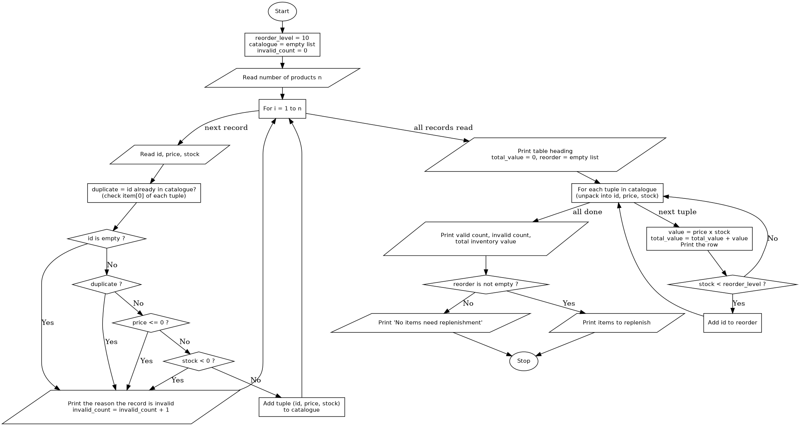

# Case Study 49: Tuple-Based Product Catalogue Audit

## 1. Problem Statement
Write a Python program that stores product identifiers, prices and stock quantities in tuples, detects invalid records, calculates the inventory value of each product and of the whole catalogue, and identifies the items that require replenishment.

## 2. Objectives
- To store each product record as a tuple `(id, price, stock)` and keep the valid records in a list.
- To use tuple indexing and tuple unpacking to read and process the records.
- To detect invalid records (empty id, duplicate id, non-positive price, negative stock) using conditional statements.
- To calculate inventory values and a total, and to print a neatly aligned table.
- To identify items whose stock is below the reorder level.

## 3. Assumptions
- The number of products and the details of each product (id, price, stock) are entered by the user, one value at a time.
- A record is **invalid** if the product id is empty, if the id has already been used by an earlier valid record (duplicate), if the price is 0 or less, or if the stock is negative. Invalid records are reported and are not added to the catalogue.
- The inventory value of a product is price x stock, and the total inventory value is the sum for all valid products.
- The **reorder level is 10**. A product needs replenishment if its stock is **below** 10 (a stock of exactly 10 does not need replenishment).
- The price is a number and the stock is a whole number. (The program does not validate the input type.)
- Functions are outside the assigned syllabus, so none are used.

## 4. Algorithm
1. Start.
2. Set `reorder_level = 10`, create an empty list `catalogue`, and set `invalid_count = 0`.
3. Read the number of products `n`.
4. For each record from 1 to `n`:
   1. Read the product id, price and stock.
   2. Check whether the id already appears as the first element of any tuple in `catalogue` (duplicate).
   3. If the id is empty, print an invalid message and add 1 to `invalid_count`.
   4. Otherwise, if the id is a duplicate, print an invalid message and add 1 to `invalid_count`.
   5. Otherwise, if the price is 0 or less, print an invalid message and add 1 to `invalid_count`.
   6. Otherwise, if the stock is negative, print an invalid message and add 1 to `invalid_count`.
   7. Otherwise, add the tuple `(id, price, stock)` to `catalogue`.
5. Print the table heading. Set `total_value = 0` and create an empty list `reorder`.
6. For each tuple in `catalogue`, unpack it into `id`, `price` and `stock`:
   1. Calculate `value = price x stock`, add it to `total_value`, and print the row.
   2. If `stock` is less than `reorder_level`, add the id to `reorder`.
7. Print the number of valid records, the number of invalid records and the total inventory value.
8. If `reorder` is not empty, print the items to replenish. Otherwise, print that no items need replenishment.
9. Stop.

## 5. Pseudocode
```
START
    reorder_level = 10
    catalogue = empty list
    invalid_count = 0
    READ n
    FOR i = 1 TO n
        READ id, price, stock
        duplicate = FALSE
        FOR each item in catalogue
            IF first element of item = id THEN duplicate = TRUE
        END FOR
        IF id is empty THEN
            PRINT "invalid: empty id"; invalid_count = invalid_count + 1
        ELSE IF duplicate THEN
            PRINT "invalid: duplicate id"; invalid_count = invalid_count + 1
        ELSE IF price <= 0 THEN
            PRINT "invalid: price"; invalid_count = invalid_count + 1
        ELSE IF stock < 0 THEN
            PRINT "invalid: stock"; invalid_count = invalid_count + 1
        ELSE
            ADD tuple (id, price, stock) TO catalogue
        END IF
    END FOR
    total_value = 0
    reorder = empty list
    FOR each (id, price, stock) in catalogue
        value = price * stock
        total_value = total_value + value
        PRINT id, price, stock, value
        IF stock < reorder_level THEN ADD id TO reorder
    END FOR
    PRINT number of valid records, invalid_count, total_value
    IF reorder is not empty THEN
        PRINT reorder
    ELSE
        PRINT "no items need replenishment"
    END IF
STOP
```

## 6. Flowchart


## 7. Python Source Code
See [`catalogue_audit.py`](catalogue_audit.py).

```python
# This program audits a product catalogue stored as tuples (id, price, stock).
# It detects invalid records, calculates inventory values and lists items to replenish.
reorder_level = 10
n = int(input("Number of products: "))

catalogue = []
invalid_count = 0

for i in range(1, n + 1):
    pid = input("Product " + str(i) + " - id: ")
    price = float(input("Product " + str(i) + " - price: "))
    stock = int(input("Product " + str(i) + " - stock quantity: "))

    duplicate = False
    for item in catalogue:
        if item[0] == pid:
            duplicate = True

    if pid == "":
        print("Record", i, "invalid: empty product id")
        invalid_count = invalid_count + 1
    elif duplicate:
        print("Record", i, "invalid: duplicate product id", pid)
        invalid_count = invalid_count + 1
    elif price <= 0:
        print("Record", i, "invalid: price must be greater than 0")
        invalid_count = invalid_count + 1
    elif stock < 0:
        print("Record", i, "invalid: stock cannot be negative")
        invalid_count = invalid_count + 1
    else:
        catalogue.append((pid, price, stock))

print("\n--- Valid Catalogue ---")
print(f"{'ID':<8}{'Price':>10}{'Stock':>8}{'Value':>12}")

total_value = 0
reorder = []
for pid, price, stock in catalogue:
    value = price * stock
    total_value = total_value + value
    print(f"{pid:<8}{price:>10.2f}{stock:>8}{value:>12.2f}")
    if stock < reorder_level:
        reorder.append(pid)

print("\n--- Summary ---")
print("Valid records  :", len(catalogue))
print("Invalid records:", invalid_count)
print(f"Total inventory value: {total_value:.2f}")
if len(reorder) > 0:
    print("Items to replenish (stock below", reorder_level, "):", reorder)
else:
    print("No items need replenishment.")
```

## 8. Test Cases
Each product is given as (id, price, stock).

| No. | Inputs | Expected Output | Actual Output | Result |
|----|--------|-----------------|---------------|--------|
| 1 | 6 products: (P101, 250.50, 40) (P102, 1200, 5) (P103, 99.99, 0) (P104, -20, 10) (P101, 300, 10) (P105, 45.25, 25) | Record 4 invalid (price), record 5 invalid (duplicate id). 4 valid, 2 invalid. Total 17151.25. Replenish: P102, P103 | Same as expected | Pass |
| 2 | 3 products: (A1, 10, 50) (A2, 20, 30) (A3, 5.5, 12) | All valid. Values 500.00, 600.00, 66.00. Total 1166.00. No items need replenishment | Same as expected | Pass |
| 3 | 2 products: (empty id, 10, 5) (B1, 10.5, 3) | Record 1 invalid (empty id). 1 valid, 1 invalid. Total 31.50. Replenish: B1 | Same as expected | Pass |
| 4 | 2 products: (C1, 15, -3) (C2, 15, 4) | Record 1 invalid (negative stock). 1 valid, 1 invalid. Total 60.00. Replenish: C2 | Same as expected | Pass |
| 5 | 1 product: (D1, 100, 10) | Value 1000.00. Total 1000.00. No items need replenishment (stock of exactly 10 is not below the level) | Same as expected | Pass |

## 9. Output Screenshots
| Test 1 | Test 2 | Test 3 |
|---|---|---|
|  |  |  |

| Test 4 | Test 5 |
|---|---|
|  |  |

## 10. Conclusion
The program stores each valid product as a tuple in a list, rejects records with an empty or duplicate id, a non-positive price or a negative stock, and uses tuple unpacking to calculate each product's inventory value and the total. It lists the products whose stock is below the reorder level of 10. The test cases confirm the results for invalid records, exactly-at-the-level stock and a fully valid catalogue. The program uses a fixed reorder level, assumes numeric input without checking the type, and does not use functions because they were outside the assigned syllabus.
