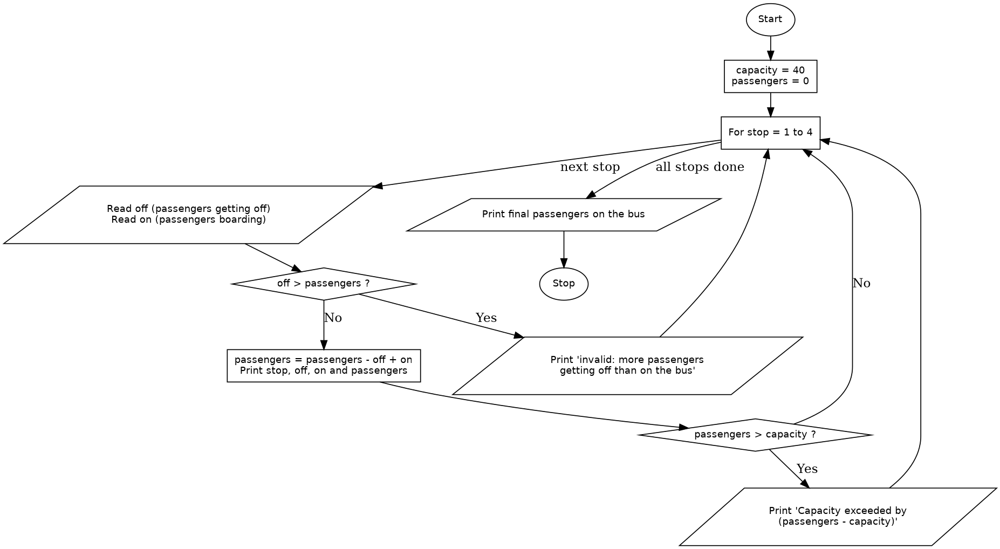

# Case Study 51: Bus Passenger Occupancy Simulation

## 1. Problem Statement
Write a Python program that processes the number of passengers boarding and getting off a bus at multiple stops, calculates the number of passengers on the bus after each stop, and flags any stop where the bus capacity is exceeded.

## 2. Objectives
- To use a loop to process data stop by stop while keeping a running total.
- To update a value using subtraction and addition in the correct order.
- To use conditional statements to detect capacity violations and invalid records.
- To display the result for every stop in a clear, formatted way.

## 3. Assumptions
- The bus capacity is fixed at **40** passengers.
- The bus makes **4** stops, and the bus is empty before the first stop.
- At each stop, the passengers getting off leave first, and then the boarding passengers get on.
- The inputs are whole numbers that are zero or more. (The program does not check the type of the input, so letters or negative numbers are not handled.)
- A passenger count of exactly 40 is allowed. A violation occurs only when the count is **more than** 40.
- If a stop goes over capacity, the stop is flagged and the full count is kept (no passengers are turned away).
- If more passengers are recorded getting off than are on the bus, the record for that stop is invalid: a message is printed, and the passenger count is left unchanged (the boarding number for that stop is also ignored).
- Functions and lists are not needed for this version, so the program is written with a loop and simple variables.

## 4. Algorithm
1. Start.
2. Set `capacity = 40` and `passengers = 0`.
3. For each stop from 1 to 4:
   1. Read the number of passengers getting off (`off`).
   2. Read the number of passengers boarding (`on`).
   3. If `off` is greater than `passengers`, print an invalid-record message for this stop.
   4. Otherwise, calculate `passengers = passengers - off + on` and print the stop number, `off`, `on` and the new passenger count.
   5. If `passengers` is greater than `capacity`, print that the capacity is exceeded and by how many passengers.
4. After all stops, print the final number of passengers on the bus.
5. Stop.

## 5. Pseudocode
```
START
    capacity = 40
    passengers = 0
    FOR stop = 1 TO 4
        READ off
        READ on
        IF off > passengers THEN
            PRINT "invalid: more passengers getting off than are on the bus"
        ELSE
            passengers = passengers - off + on
            PRINT stop, off, on, passengers
            IF passengers > capacity THEN
                PRINT "capacity exceeded by", passengers - capacity
            END IF
        END IF
    END FOR
    PRINT "final passengers on the bus", passengers
STOP
```

## 6. Flowchart


## 7. Python Source Code
See [`bus_occupancy.py`](bus_occupancy.py).

```python
# This program simulates passengers boarding and leaving a bus at 4 stops
# and flags every stop where the bus goes over its capacity.
capacity = 40
passengers = 0

for stop in range(1, 5):
    off = int(input("Passengers getting off at stop " + str(stop) + ": "))
    on = int(input("Passengers boarding at stop " + str(stop) + ": "))

    if off > passengers:
        print("Stop", stop, ": invalid, more passengers getting off than are on the bus")
    else:
        passengers = passengers - off + on
        print("Stop", stop, ": off", off, ", on", on, "->", passengers, "passengers")
        if passengers > capacity:
            print("  Capacity exceeded by", passengers - capacity)

print("Final passengers on the bus:", passengers)
```

## 8. Test Cases
In each case the inputs are given as (off, on) for stops 1 to 4.

| No. | Inputs (off, on) per stop | Expected Output | Actual Output | Result |
|----|---------------------------|-----------------|---------------|--------|
| 1 | (0,15) (3,10) (5,30) (18,4) | Counts 15, 22, 47, 33. Stop 3 exceeds capacity by 7. Final 33 | Same as expected | Pass |
| 2 | (0,10) (2,8) (5,6) (10,4) | Counts 10, 16, 17, 11. No violations. Final 11 | Same as expected | Pass |
| 3 | (0,20) (0,10) (0,10) (0,0) | Counts 20, 30, 40, 40. No violations (exactly 40 is allowed). Final 40 | Same as expected | Pass |
| 4 | (0,10) (15,5) (2,5) (3,5) | Count 10, stop 2 invalid (15 getting off, only 10 on the bus), then 13, 15. Final 15 | Same as expected | Pass |
| 5 | (0,30) (0,20) (0,10) (0,5) | Counts 30, 50, 60, 65. Stops 2, 3 and 4 exceed capacity by 10, 20 and 25. Final 65 | Same as expected | Pass |

## 9. Output Screenshots
| Test 1 | Test 2 | Test 3 |
|---|---|---|
|  |  |  |

| Test 4 | Test 5 |
|---|---|
|  |  |

## 10. Conclusion
The program tracks the number of passengers on a bus across four stops by subtracting the passengers who get off and adding those who board. It flags every stop where the count goes over the capacity of 40 and rejects stops where more passengers are recorded getting off than are on the bus. The test cases show that the running total carries correctly from stop to stop, that a count of exactly 40 is allowed, and that the count can go back under the limit after passengers leave. The program uses a fixed capacity and a fixed number of stops, and it does not validate the type of the input.
