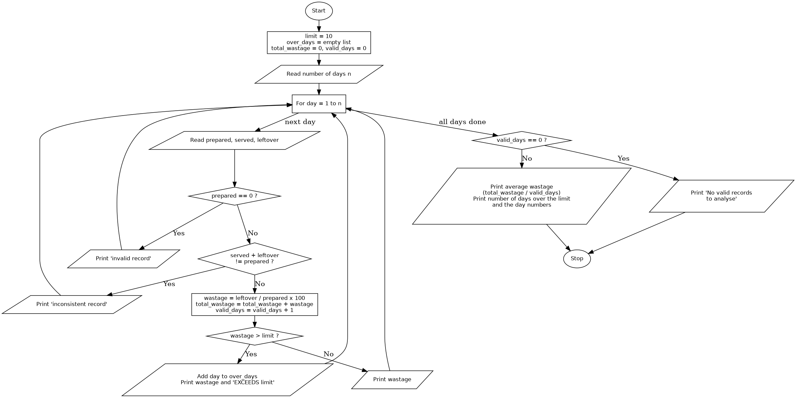

# Case Study 53: Food Waste Monitoring System

## 1. Problem Statement
Write a Python program that processes the number of meals prepared, meals served and meals left over across several days, calculates the wastage percentage for each day, validates each record, and identifies the days on which the wastage exceeds the acceptable limit.

## 2. Objectives
- To read and process a set of daily records using a loop.
- To calculate a wastage percentage and compare it with a limit using conditional statements.
- To validate records (no meals prepared, or served + leftover not equal to prepared) and leave invalid records out of the analysis.
- To use a list and a running total to build a summary: the average wastage and the days over the limit.

## 3. Assumptions
- The acceptable wastage limit is **10%**. A wastage of exactly 10% is allowed; a day is flagged only if the wastage is **more than** 10%.
- Wastage percentage = leftover meals / meals prepared x 100.
- The number of days is entered by the user, and the three values for each day are entered one at a time.
- A record is **invalid** if the meals prepared is 0, and **inconsistent** if meals served + leftover meals is not equal to the meals prepared. Such records are reported and are not used in the average or the count of days over the limit.
- The inputs are whole numbers that are zero or more. (The program does not validate the input type.)
- The average wastage is the average of the valid days' percentages.
- Functions are outside the assigned syllabus, so none are used.

## 4. Algorithm
1. Start.
2. Set `limit = 10`, create an empty list `over_days`, and set `total_wastage = 0` and `valid_days = 0`.
3. Read the number of days `n`.
4. For each day from 1 to `n`:
   1. Read the meals prepared, meals served and leftover meals.
   2. If the meals prepared is 0, print an invalid-record message.
   3. Otherwise, if served + leftover is not equal to prepared, print an inconsistent-record message.
   4. Otherwise:
      1. Calculate `wastage = leftover / prepared x 100`.
      2. Add the wastage to `total_wastage` and add 1 to `valid_days`.
      3. If the wastage is greater than the limit, add the day number to `over_days` and print the wastage with an "exceeds the limit" note.
      4. Otherwise, print the wastage.
5. If `valid_days` is 0, print that there are no valid records to analyse.
6. Otherwise, print the average wastage (`total_wastage / valid_days`), the number of days over the limit, and the day numbers if there are any.
7. Stop.

## 5. Pseudocode
```
START
    limit = 10
    over_days = empty list
    total_wastage = 0
    valid_days = 0
    READ n
    FOR day = 1 TO n
        READ prepared, served, leftover
        IF prepared = 0 THEN
            PRINT "invalid record"
        ELSE IF served + leftover != prepared THEN
            PRINT "inconsistent record"
        ELSE
            wastage = leftover / prepared * 100
            total_wastage = total_wastage + wastage
            valid_days = valid_days + 1
            IF wastage > limit THEN
                ADD day TO over_days
                PRINT wastage, "exceeds the limit"
            ELSE
                PRINT wastage
            END IF
        END IF
    END FOR
    IF valid_days = 0 THEN
        PRINT "no valid records to analyse"
    ELSE
        PRINT total_wastage / valid_days
        PRINT length of over_days
        IF over_days is not empty THEN PRINT over_days
    END IF
STOP
```

## 6. Flowchart


## 7. Python Source Code
See [`food_waste.py`](food_waste.py).

```python
# This program monitors food wastage over several days, calculates the wastage
# percentage for each day and finds the days that exceed the acceptable limit.
limit = 10
n = int(input("Number of days: "))

over_days = []
total_wastage = 0
valid_days = 0

for day in range(1, n + 1):
    prepared = int(input("Day " + str(day) + " - meals prepared: "))
    served = int(input("Day " + str(day) + " - meals served: "))
    leftover = int(input("Day " + str(day) + " - leftover meals: "))

    if prepared == 0:
        print("Day", day, ": invalid record, no meals prepared")
    elif served + leftover != prepared:
        print("Day", day, ": inconsistent record, served + leftover is not equal to prepared")
    else:
        wastage = leftover / prepared * 100
        total_wastage = total_wastage + wastage
        valid_days = valid_days + 1
        if wastage > limit:
            over_days.append(day)
            print(f"Day {day}: wastage {wastage:.2f}% - EXCEEDS the {limit}% limit")
        else:
            print(f"Day {day}: wastage {wastage:.2f}%")

print("\n--- Summary ---")
if valid_days == 0:
    print("No valid records to analyse.")
else:
    print(f"Average wastage over {valid_days} valid day(s): {total_wastage / valid_days:.2f}%")
    print("Days over the limit:", len(over_days))
    if len(over_days) > 0:
        print("Day numbers:", over_days)
```

## 8. Test Cases
Each day's inputs are given as (prepared, served, leftover).

| No. | Inputs | Expected Output | Actual Output | Result |
|----|--------|-----------------|---------------|--------|
| 1 | 3 days: (200,180,20) (150,120,30) (100,95,5) | Wastage 10.00%, 20.00% (exceeds limit), 5.00%. Average 11.67%. 1 day over the limit: day 2 | Same as expected | Pass |
| 2 | 3 days: (200,180,5) (0,0,0) (100,90,10) | Day 1 inconsistent, day 2 invalid, day 3 wastage 10.00%. Average 10.00%. 0 days over the limit | Same as expected | Pass |
| 3 | 1 day: (0,0,0) | Day 1 invalid. "No valid records to analyse." | Same as expected | Pass |
| 4 | 2 days: (100,100,0) (80,60,20) | Wastage 0.00%, 25.00% (exceeds limit). Average 12.50%. 1 day over the limit: day 2 | Same as expected | Pass |
| 5 | 1 day: (100,90,10) | Wastage 10.00% (not flagged, exactly at the limit). Average 10.00%. 0 days over the limit | Same as expected | Pass |

## 9. Output Screenshots
| Test 1 | Test 2 | Test 3 |
|---|---|---|
|  |  |  |

| Test 4 | Test 5 |
|---|---|
|  |  |

## 10. Conclusion
The program reads daily meal records, calculates the wastage percentage for each valid day, and flags the days that go over the 10% limit. Invalid and inconsistent records are reported and left out, so they do not distort the average. The test cases confirm the behaviour at the limit (exactly 10% is not flagged), with no leftovers, and with no valid records at all. The program uses a fixed limit, assumes whole-number input, and does not use functions because they were outside the assigned syllabus.
